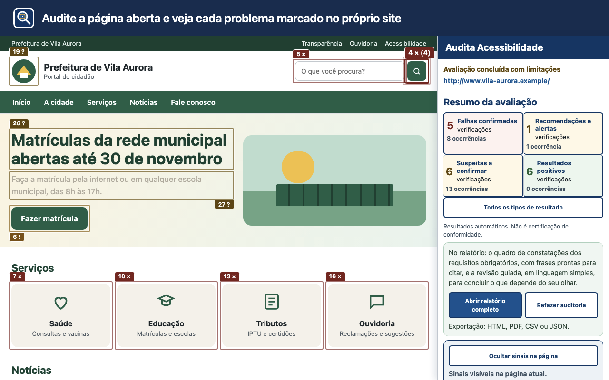
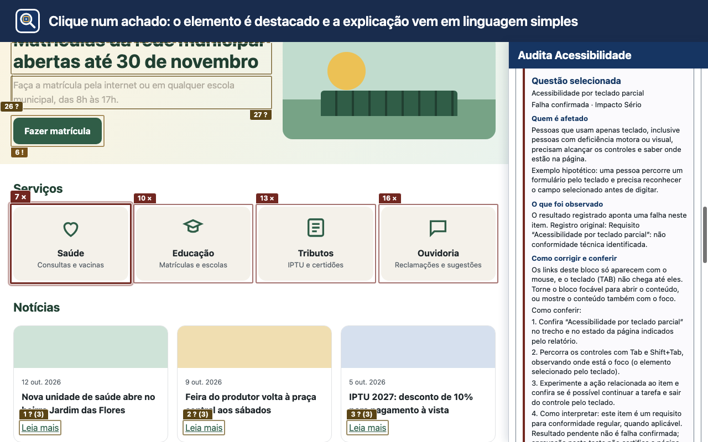
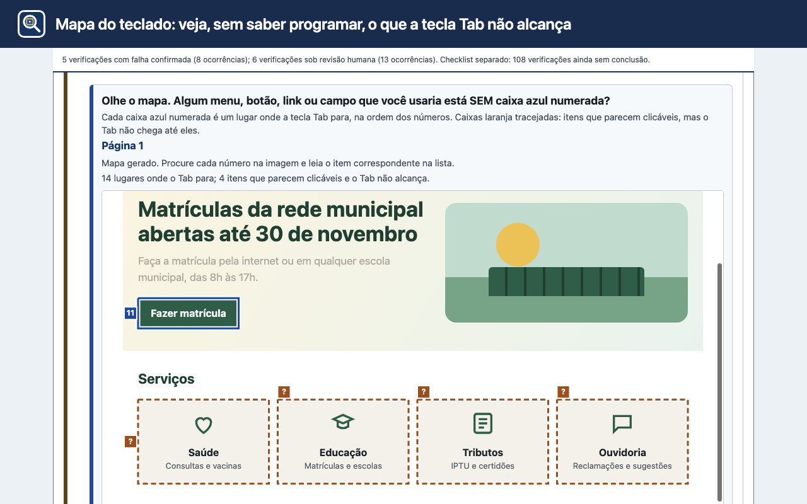
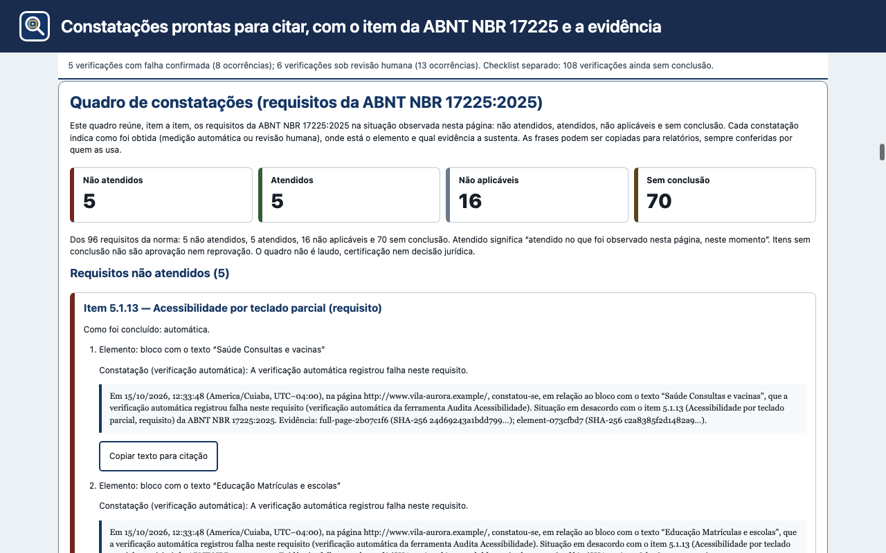
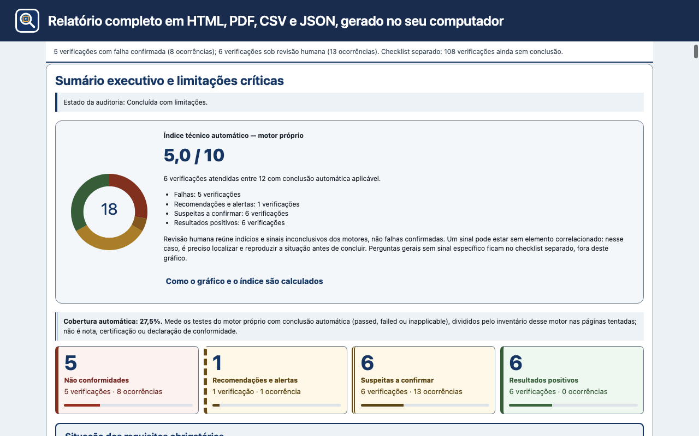

<p align="center">
  
</p>

<h1 align="center">Audita Acessibilidade</h1>

<p align="center">
  Extensão gratuita e de código aberto para o Chrome que audita a acessibilidade de páginas web conforme a
  <strong>WCAG 2.2</strong> e a <strong>ABNT NBR 17225:2025</strong>, com evidências, revisão humana guiada e
  relatórios gerados inteiramente no seu computador.
</p>

<p align="center">
  <a href="https://chromewebstore.google.com/detail/audita-acessibilidade/pehaoepmcnngopfknnmlbfdhcimfdccb"></a>
  <a href="https://chromewebstore.google.com/detail/audita-acessibilidade/pehaoepmcnngopfknnmlbfdhcimfdccb"></a>
  <a href="https://github.com/andrebadini/acessibilidade-digital/releases/latest"></a>
  <a href="https://github.com/andrebadini/acessibilidade-digital/actions/workflows/ci.yml"></a>
  <a href="LICENSE"></a>
  
  
  
</p>

<p align="center">
  <a href="https://chromewebstore.google.com/detail/audita-acessibilidade/pehaoepmcnngopfknnmlbfdhcimfdccb"><strong>Instalar pela Chrome Web Store</strong></a>
  ·
  <a href="https://github.com/andrebadini/acessibilidade-digital/releases/latest">Baixar o pacote</a>
  ·
  <a href="docs/COMO-USAR.md">Guia de uso</a>
  ·
  <a href="docs/ENTENDER-O-RESULTADO.md">Entender o resultado</a>
  ·
  <a href="CHANGELOG.md">Histórico de versões</a>
</p>

---

## Sumário

- [Por que usar](#por-que-usar)
- [Recursos](#recursos)
- [Capturas de tela](#capturas-de-tela)
- [Instalação](#instalação)
- [Uso básico](#uso-básico)
- [Privacidade e permissões](#privacidade-e-permissões)
- [Limites](#limites)
- [Desenvolvimento](#desenvolvimento)
- [Estrutura do projeto](#estrutura-do-projeto)
- [Como contribuir](#como-contribuir)
- [Licença](#licença)

## Por que usar

- **Sem servidor.** O processamento local acontece no seu Chrome: o conteúdo auditado não é enviado a nenhum serviço
  externo, e não há conta, login ou telemetria.
- **Norma brasileira e WCAG lado a lado.** Cada ocorrência aponta o item da ABNT NBR 17225:2025 e o critério WCAG 2.2
  correspondentes, com explicação em linguagem simples, exemplo de correção e evidência.
- **Automação honesta.** O que a máquina consegue concluir aparece como falha, alerta ou aprovado; o que depende de
  julgamento humano vira uma pergunta clara na revisão guiada. A ferramenta não declara conformidade que não pode
  comprovar.
- **Relatórios prontos para entregar.** Exporte HTML autocontido, PDF, CSV e JSON-LD/EARL, com capturas, recortes de
  cada elemento e hashes SHA-256 das evidências.

## Recursos

| Recurso | O que faz |
| --- | --- |
| 🔎 **Três alvos de auditoria** | A página atual, **Outra URL** informada por você ou um **Lote de páginas** de 2 a 20 URLs com relatório consolidado. |
| 🖼️ **Três modos de evidência** | **Evidência completa**, **Somente elementos** ou **Sem imagens**. |
| 📍 **Sinais na própria página** | Marcadores numerados sobre os elementos com falha (×), alerta (!), revisão (?) ou aprovado (✓). |
| ⌨️ **Mapa do teclado** | Uma caixa numerada em cada parada do Tab e, à parte, o que parece clicável mas o teclado não alcança. |
| 🗣️ **Mapa de leitura** | Códigos curtos sobre a página e, ao lado, o que um leitor de tela falaria em cada ponto. |
| 🧭 **Revisão humana guiada** | Cada pendência vira uma pergunta sobre o que se vê (Sim, Não, Não consegui verificar), com destaque, zoom de 200 %, largura de celular e espaçamento de leitura. |
| 🔁 **Leitura por Tab** | Percurso guiado pela sequência de foco, com ou sem áudio (voz instalada no computador, sem vozes on-line). |
| 📋 **Quadro de constatações** | A situação de cada requisito da norma e frases prontas para citação, com página, elemento, data e evidência. |
| 👥 **Personas** | Simulações de leitor de tela, acromatopsia e navegação por teclado. |
| 📦 **Exportação** | Um botão por formato (PDF, HTML, CSV, JSON) e "Baixar todos os formatos". |

O motor combina regras próprias com o [axe-core](https://github.com/dequelabs/axe-core), empacotado na extensão (sem
código remoto).

## Capturas de tela

As capturas mostram a extensão real sobre um portal fictício de demonstração
([`store-assets/demo/vila-aurora.html`](store-assets/demo/vila-aurora.html)).

| Sinais na página | Explicação de cada ocorrência |
| --- | --- |
|  |  |
| **Mapa do teclado** | **Quadro de constatações** |
|  |  |

<p align="center">
  
  <br><em>Relatório completo, pronto para exportar.</em>
</p>

## Instalação

### Pela Chrome Web Store (recomendado)

Instale em
**[Audita Acessibilidade na Chrome Web Store](https://chromewebstore.google.com/detail/audita-acessibilidade/pehaoepmcnngopfknnmlbfdhcimfdccb)**.
As atualizações chegam automaticamente. Requer Chrome 116 ou mais recente.

### Pelo pacote da release

1. Baixe `audita-acessibilidade-<versão>.zip` na
   [página de releases](https://github.com/andrebadini/acessibilidade-digital/releases/latest) e descompacte-o numa
   pasta.
2. Abra `chrome://extensions` e ative o **Modo do desenvolvedor**.
3. Escolha **Carregar sem compactação** e selecione a pasta que contém o `manifest.json`.
4. Fixe o ícone na barra do Chrome, se desejar. O atalho `Alt+Shift+A` (`Ctrl+Shift+A` no macOS) abre o painel.

### A partir do código-fonte

```sh
git clone https://github.com/andrebadini/acessibilidade-digital.git
```

Carregue a pasta clonada com **Carregar sem compactação**. O `manifest.json` fica na raiz e não há etapa de build para
usar a extensão.

## Uso básico

1. Abra a página que deseja examinar e clique no ícone da extensão. O painel lateral se abre ao lado da página.
2. Escolha o modo de evidência: **Evidência completa**, **Somente elementos** ou **Sem imagens**.
3. Selecione **Auditar a página atual**. Abrir o painel não inicia a coleta: esse botão é a confirmação explícita.
   A inspeção acontece na própria página e somente para leitura: a extensão não cria aba, não navega, não rola e não
   move o foco durante a coleta.
4. Acompanhe as cinco etapas da avaliação. Ao final, o painel mostra o sumário, os filtros e as fichas das ocorrências,
   agrupadas por item da ABNT.
5. Use **Mostrar sinais na página** para ver cada elemento marcado e **Abrir relatório completo** para a revisão guiada.
6. A exportação baixa HTML autocontido, PDF, CSV e JSON-LD/EARL, cada formato no seu botão ou todos de uma vez.

Para auditar outro endereço, escolha **Outra URL**; para várias páginas, **Lote de páginas** (de 2 a 20 URLs, uma por
linha). Nesses casos cada endereço é aberto em uma aba temporária inativa, removida ao final.

O passo a passo completo está no [guia de uso](docs/COMO-USAR.md), e o significado de cada número, em
[Entender o resultado](docs/ENTENDER-O-RESULTADO.md).

## Privacidade e permissões

As auditorias ficam no dispositivo por até 30 dias desde o primeiro registro, e **Excluir auditoria local** apaga uma
auditoria a qualquer momento. A extensão não envia o conteúdo coletado para um servidor. Antes de auditar, oculte dados
pessoais ou sigilosos visíveis, porque as capturas entram nos relatórios baixados.

| Permissão | Para quê |
| --- | --- |
| `debugger` | Usar localmente o Chrome DevTools Protocol na página escolhida: árvore de acessibilidade, capturas e PDF. |
| `tabs`, `scripting` | Identificar a aba auditada e inspecioná-la; aplicar zoom ou espaçamento de leitura a pedido. |
| `sidePanel` | Manter a interface ao lado da página. |
| `downloads` | Salvar os relatórios exportados. |
| `storage` | Guardar auditorias e andamento no dispositivo. |
| `alarms` | Expirar estados temporários e auditorias antigas. |
| `contextMenus` | Oferecer um atalho opcional no menu de contexto. |
| `http://*/*`, `https://*/*` | Auditar a página que você escolher. |

Leia a [Política de Privacidade](docs/POLITICA-DE-PRIVACIDADE.md) completa.

## Limites

A extensão audita os estados observados de uma página, de outra URL ou de um lote explícito, e não todo o serviço.
Itens contextuais exigem revisão humana, e frames de terceiros, canvas, vídeo ou conteúdo protegido podem produzir
resultado parcial. A prévia de anúncio é uma estimativa a partir das propriedades de acessibilidade, não a fala literal
de um leitor de tela. Audita Acessibilidade é uma ferramenta independente, sem vínculo institucional: o relatório apoia
a análise técnica, mas não equivale a certificação nem a laudo oficial.

## Desenvolvimento

Requisitos: [Node.js](https://nodejs.org/) 22 ou mais recente e `zip`/`unzip`. Para os testes de ponta a ponta,
o [Chrome for Testing](https://googlechromelabs.github.io/chrome-for-testing/).

```sh
npm install                                  # axe-core usado na verificação do vendor
AUDITA_VERIFY_SKIP_TESTS=1 npm run verify    # manifesto, CSP, axe empacotado e identidade neutra
node --test test/core/*.test.js              # testes da área que você mudou
npm test                                     # suíte lógica completa
npm run build:release                        # gera release/audita-acessibilidade-<versão>.zip
```

Os testes E2E (`test/e2e/`) abrem um Chrome real com a extensão carregada; defina
`AUDITA_E2E_CHROME=<caminho do Chrome for Testing>` para executá-los. O pacote gerado por `npm run build:release`
contém somente o manifesto, o código executável, o axe-core empacotado e os ícones, com `manifest.json` na raiz, e é
reprodutível byte a byte: `test/release-package.test.js` compara o hash do ZIP com o registrado.

## Estrutura do projeto

```text
.
├── manifest.json        Manifesto MV3
├── src/
│   ├── background/      Service worker: orquestra auditoria, CDP, capturas e exportação
│   ├── collector/       Coleta na página auditada
│   ├── core/            Regras, mapeamento ABNT/WCAG e relatórios
│   ├── panel/           Painel lateral
│   ├── review/          Revisão humana guiada
│   ├── reader/          Leitura por Tab e anúncios estimados
│   ├── personas/        Simulações de leitor de tela, acromatopsia e teclado
│   ├── export/          Exportação HTML, PDF, CSV e JSON-LD/EARL
│   └── storage/ ui/ browser/
├── vendor/axe/          axe-core empacotado (MPL-2.0)
├── assets/icons/        Ícones da extensão
├── test/                Testes unitários, de integração e E2E (node:test)
├── fixtures/            Páginas e auditorias de exemplo
├── scripts/             Build, verificação e QA
├── store-assets/        Textos, imagens e capturas da Chrome Web Store
├── release/             Pacote da versão atual (e o pacote revisado da 1.1.15)
└── docs/                Guias de uso, política de privacidade e notas de versão
```

## Como contribuir

Contribuições são bem-vindas: relatos de falso positivo, sugestões de regras, melhorias de texto e de código. Leia o
[guia de contribuição](CONTRIBUTING.md) e o [código de conduta](CODE_OF_CONDUCT.md) antes de abrir uma issue ou um
pull request. Vulnerabilidades devem ser relatadas em particular, conforme a [política de segurança](SECURITY.md).

## Licença

Distribuído sob a [licença MIT](LICENSE). O axe-core, incluído em `vendor/axe/`, é da Deque Systems e distribuído sob a
[Mozilla Public License 2.0](vendor/axe/LICENSE). A ABNT NBR 17225 é norma da Associação Brasileira de Normas Técnicas;
este projeto a referencia e não reproduz seu texto integral.
